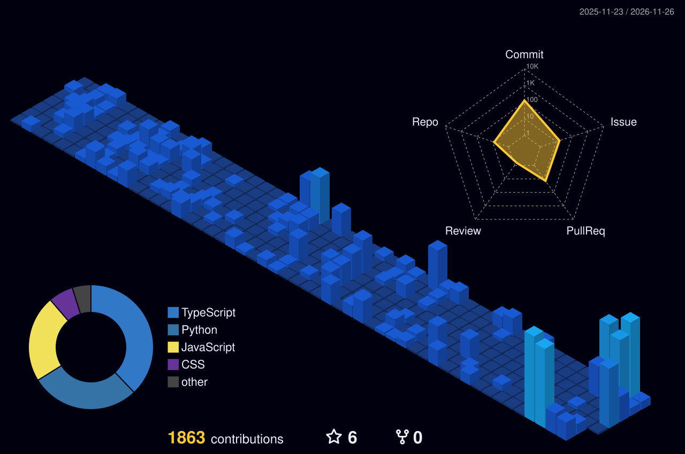

## ⚔️ Dungeons cleared

| Dungeon | What it is | Weapons used |
|---|---|---|
| [**Hammer**](https://github.com/CrisjoSsj/Supabase-hackathon) | Live auctions with realtime bids, room presence and an AI narrator | `Next.js` `Supabase` `OpenAI` |
| [**Chuwue Grill**](https://github.com/CrisjoSsj/Proyecto-autonomo-servidores) | Restaurant platform built on microservices | `TypeScript` `Python` `Go` `Ruby` |
| [**Bus Tracker Manta**](https://github.com/CrisjoSsj/traking-bus) | Installable app for bus routes, stops and arrival times | `React` `TypeScript` `Supabase` |
| [**Supabase AI Bridge**](https://github.com/CrisjoSsj/supabase-ai-bridge) | Connects Supabase to AI models for plug-and-play chatbots | `TypeScript` `Edge Functions` |
| [**claude-config**](https://github.com/CrisjoSsj/claude-config) | Shared Claude Code setup with rules, hooks and templates | `JavaScript` `Shell` |

### 🌌 Shadow city

*Every commit raises another tower.*

